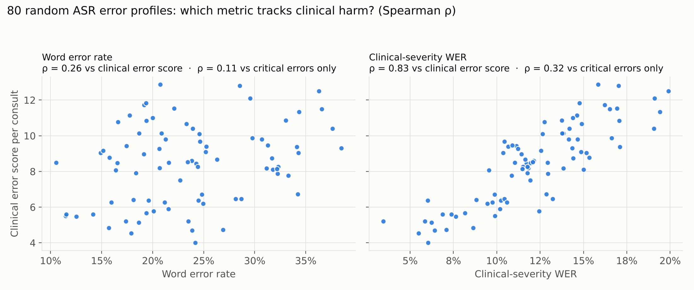

# hinglish-opd-scribe

**An open-source Hindi–English (Hinglish) OPD scribe that turns a consult into a
SNOMED-coded, FHIR-formatted note, remembers past visits, and is scored on
clinical severity instead of plain word error rate.**

Computing for Medicine (IIIT-Delhi) course project, aligned with the AMR Voice
Clinical / VoiceScribe direction: multilingual, evidence-linked clinical
documentation for noisy Indian OPDs, with antimicrobial-stewardship checks.

> ⚠️ Research prototype. Notes are drafts (`status: preliminary`) that a doctor
> must review. No real patient data is used. SNOMED codes must be validated
> against the SNOMED CT India release before any clinical use.

## What it does

```
audio ──ASR──▶ diarised turns ──▶ Hinglish normalisation ──▶ fact extraction ──▶ safety checks ──▶ FHIR R4 document
 (Whisper / AWS     (doctor/patient     (romanise Devanagari,     (symptoms ± negation,    (allergy × drug,      (Composition, Condition,
  Transcribe,        role assignment)    spelling-variant keys,     durations, history,      antibiotic for viral   AllergyIntolerance,
  ap-south-1)                            number words)              diagnosis, meds,         dx, NSAID in dengue,   Observation, Medication-
                                                                    dose/freq/course,        AWaRe Watch)           Request; SNOMED + LOINC)
                                                                    vitals, allergies)            ▲
                                                         SQLite patient memory ───────────────────┘ (past allergies, chronic
                                                                                                     conditions, med reconciliation)
```

* **Hinglish-aware:** "khansi nahi hai" (Hindi negation after the noun), "No
  sir" (English), bare "Nahi ji" answers linked back to the doctor's question,
  "teen din se", "subah shaam", "zarurat pade toh", brand names (Dolo, Azithral,
  Glycomet), Devanagari words.
* **Evidence-linked:** every fact keeps the utterance it came from.
* **Memory:** an allergy told at visit 1 is checked against the prescription at visit 3.
* **Pertinent negatives survive:** absent symptoms become `Condition` with `verificationStatus = refuted`.

## Quick start

```bash
pip install -e ".[dev]"
pytest -q                                  # 22 tests
opdscribe run data/examples/consult_hinglish.json --patient DEMO --date 2026-09-01
python scripts/run_experiments.py          # all mid-term results -> results/
```

## Mid-term results (synthetic data + simulated ASR noise)

| Experiment | Result |
|---|---|
| **WER vs clinical harm** (3 simulated ASR systems, 83 consults) | System B has the *best* WER (5%) but the *most* critical errors (1.11 per consult; 70% of consults have ≥1). System A has the *worst* WER (40%) and almost none (0.02). |
| **Metric validity** (80 random ASR error profiles) | Spearman ρ with clinical error score: WER 0.26, **CS-WER 0.83**. With critical errors only: WER 0.11 (n.s.), CS-WER 0.32 (p = 0.004). |
| **Phonetic normalisation ablation** (spelling-noisy ASR) | Clinical error score per consult 13.3 → **3.7** (−72%) |
| **Visit memory** (allergy-conflict prescriptions) | Caught **7/7** with memory vs 4/7 without; 3 were only catchable from history |
| **AMR stewardship flag** (antibiotic for a viral diagnosis) | 6/6 caught, 0 false alarms |
| **FHIR** | 83/83 bundles validate (fhir.resources R4B); 97.9% of coded resources carry a SNOMED code |
| **Held-out hand-written consults** (8, untuned) | 0 critical, 12 major, 5 minor errors over 53 gold facts: mostly paraphrases outside the lexicon |




**Read these honestly.** The ASR errors are simulated, and the rule-based
extractor shares vocabulary with the synthetic generator (hence 0 errors on
clean synthetic text). The held-out set and real audio are the real tests.
See [docs/metric.md](docs/metric.md) and [docs/data_card.md](docs/data_card.md).

## Repository map

| Path | What |
|---|---|
| `src/opdscribe/normalize.py` | tokenise, Devanagari→Roman, phonetic keys, canonicalisation, number words |
| `src/opdscribe/lexicon/*.tsv` | Hinglish surface forms → SNOMED CT (symptoms, conditions, allergies, drugs + WHO AWaRe group) |
| `src/opdscribe/extract.py` | rule-based fact extraction with negation, Q→A linking, roles |
| `src/opdscribe/safety.py` | allergy conflicts, antibiotic-for-viral, NSAID-in-dengue, Watch antibiotics |
| `src/opdscribe/memory.py` | SQLite longitudinal store, prior context, medication reconciliation |
| `src/opdscribe/fhir.py` | FHIR R4 document Bundle (OPConsultRecord-style) |
| `src/opdscribe/metrics/` | WER, CS-WER, concept-level clinical error score |
| `src/opdscribe/asr/` | transcript, faster-whisper, AWS Transcribe (Mumbai) backends |
| `src/opdscribe/sim/` | synthetic consult generator, ASR-noise simulator |
| `data/` | synthetic (83), held-out (8), example consult |
| `scripts/run_experiments.py` | reproduces every number above |

## Roadmap (after mid-term)

1. **Real audio:** consented role-play recordings of the synthetic scripts; benchmark Whisper, IndicConformer/AI4Bharat models and AWS Transcribe (hi-IN) on WER vs CS-WER.
2. **Calibrate the metric:** clinicians rate a sample of real ASR errors; fit CS-WER weights to their ratings.
3. **LLM extractor** (AWS Bedrock) behind the same interface, compared with the rule baseline on the held-out set; rules stay as a safety net.
4. **Kannada** lexicon and scripts (deployment language for Karnataka).
5. Validate all codes against the SNOMED CT India release + India Drug Extension.

## License

Apache-2.0. SNOMED CT content is © SNOMED International; use in India is
covered by the free NRCeS affiliate licence.
