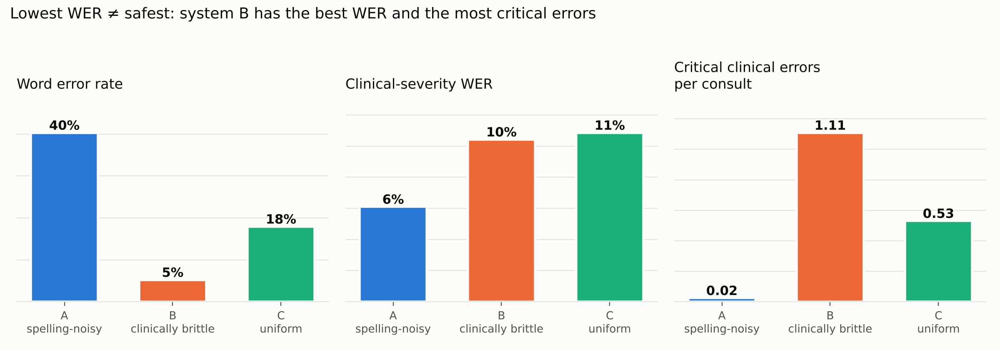
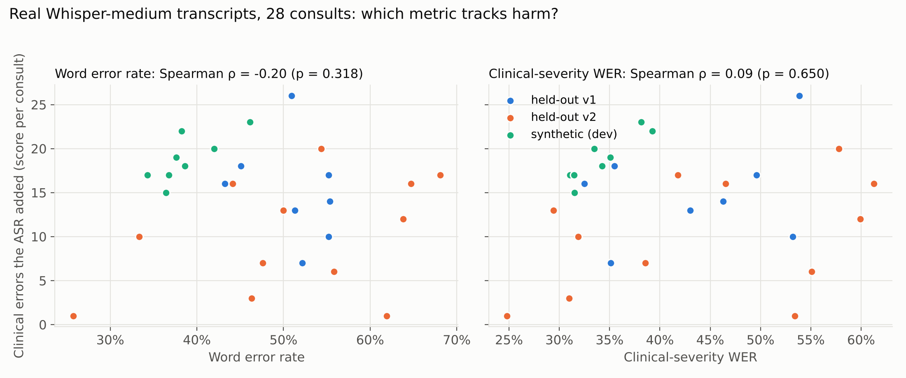

# hinglish-opd-scribe

**An open-source Hindi–English (Hinglish) OPD scribe that turns a consult into a
SNOMED-coded, FHIR-formatted note, remembers past visits, and is scored on
clinical severity instead of plain word error rate.**

Computing for Medicine (IIIT-Delhi) course project, aligned with the AMR Voice
Clinical / VoiceScribe direction: multilingual, evidence-linked clinical
documentation for noisy Indian OPDs, with antimicrobial-stewardship checks.

> ⚠️ Research prototype. Notes are drafts (`status: preliminary`) that a doctor
> must review. No real patient data is used. SNOMED codes must be validated
> against the SNOMED CT India release before any clinical use.

## What it does

```
audio ──ASR──▶ diarised turns ──▶ Hinglish normalisation ──▶ fact extraction ──▶ safety checks ──▶ FHIR R4 document
 (Whisper / AWS     (doctor/patient     (romanise Devanagari,     (symptoms ± negation,    (allergy × drug,      (Composition, Condition,
  Transcribe,        role assignment)    spelling-variant keys,     durations, history,      antibiotic for viral   AllergyIntolerance,
  ap-south-1)                            number words)              diagnosis, meds,         dx, NSAID in dengue,   Observation, Medication-
                                                                    dose/freq/course,        AWaRe Watch)           Request; SNOMED + LOINC)
                                                                    vitals, allergies)            ▲
                                                         SQLite patient memory ───────────────────┘ (past allergies, chronic
                                                                                                     conditions, med reconciliation)
```

* **Hinglish-aware:** "khansi nahi hai" (Hindi negation after the noun), "No
  sir" (English), bare "Nahi ji" answers linked back to the doctor's question,
  "teen din se", "subah shaam", "zarurat pade toh", brand names (Dolo, Azithral,
  Glycomet), Devanagari words.
* **Evidence-linked:** every fact keeps the utterance it came from.
* **Memory:** an allergy told at visit 1 is checked against the prescription at visit 3.
* **Pertinent negatives survive:** absent symptoms become `Condition` with `verificationStatus = refuted`.

## Quick start

```bash
pip install -e ".[dev]"
pytest -q                                  # 33 tests
streamlit run app/app.py                   # interactive demo
opdscribe run data/examples/consult_hinglish.json --patient DEMO --date 2026-09-01
python scripts/run_experiments.py          # all mid-term results -> results/
```

## Mid-term results (synthetic data + simulated ASR noise)

| Experiment | Result |
|---|---|
| **WER vs clinical harm** (3 simulated ASR systems, 83 consults) | System B has the *best* WER (5%) but the *most* critical errors (1.11 per consult; 70% of consults have ≥1). System A has the *worst* WER (40%) and almost none (0.02). |
| **Metric validity** (80 random ASR error profiles) | Spearman ρ with clinical error score: WER 0.26, **CS-WER 0.83**. With critical errors only: WER 0.11 (n.s.), CS-WER 0.32 (p = 0.004). |
| **Phonetic normalisation ablation** (spelling-noisy ASR) | Clinical error score per consult 13.3 → **3.7** (−72%) |
| **Visit memory** (allergy-conflict prescriptions) | Caught **7/7** with memory vs 4/7 without; 3 were only catchable from history |
| **AMR stewardship flag** (antibiotic for a viral diagnosis) | 6/6 caught, 0 false alarms |
| **FHIR** | 83/83 bundles validate (fhir.resources R4B); 97.9% of coded resources carry a SNOMED code |
| **Held-out hand-written consults** (8, untuned) | 0 critical, 12 major, 5 minor errors over 53 gold facts: mostly paraphrases outside the lexicon |




**Read these honestly.** The ASR errors are simulated, and the rule-based
extractor shares vocabulary with the synthetic generator (hence 0 errors on
clean synthetic text). The held-out set and real audio are the real tests.
See [docs/metric.md](docs/metric.md) and [docs/data_card.md](docs/data_card.md).

## After the mid-term (v0.2)

| Experiment | Result |
|---|---|
| **Real ASR** (Whisper medium, offline, on 243 spoken turns from 28 consults; synthetic Hindi TTS voice, clean audio) | WER 48%, CS-WER 41% (after normalisation). The scribe makes 0.04 critical errors per consult from clean text but **1.18 from Whisper output; 82% of consults get ≥1 ASR-induced critical error**. 22 of 33 are medicines the ASR mangled ("Crocin 650" → "क्रासिंट चे सो पचास"), 7 dose errors, 4 missed allergies. |
| **Does a transcript metric predict that harm?** (28 consults) | **No.** Spearman ρ with ASR-added clinical error score: WER −0.20, CS-WER 0.09; with critical errors: 0.25 and 0.27 (all n.s.). A post-hoc critical-word error rate also fails (0.27, n.s.). Harm is concentrated in a few drug-name failures, so **scribes must be scored on the note (concept-level clinical errors), not the transcript**. This narrows H1: the token-weighted proxy worked on simulated noise but not on real ASR. |
| **Extractor on frozen held-out v2** (12 consults written and committed before any tuning) | Major errors **32 → 18**; critical 1 → 1 ("na khoon, na bukhar"). On v1, which guided the changes: 12 → 2 (not a fair test). |
| **Cross-script normalisation** | Devanagari digits, Hindi number words ("साढ़े छह सौ" → 650), clinical loanwords, fused postpositions ("दिन्से"), consonant-skeleton drug matching ("पैरासिटामोल" ↔ paracetamol), Indian 1-0-1 dosing. |
| **New tools** | Streamlit demo (`app/`), clinician calibration kit (114 items + agreement + weight fitting), LLM extractor arm with evidence validation and rule safety net (built, **not yet evaluated**). |



Method notes: normaliser changes were guided only by the synthetic (dev) transcripts and frozen (commit 9732678) before scoring held-out ASR output. Speech is one clean synthetic voice, so these are optimistic numbers. Details: [docs/asr_benchmark.md](docs/asr_benchmark.md), `results/asr/asr_analysis.json`, `results/extractor_progress.json`.

## Repository map

| Path | What |
|---|---|
| `src/opdscribe/normalize.py` | tokenise, Devanagari→Roman, phonetic keys, canonicalisation, number words |
| `src/opdscribe/lexicon/*.tsv` | Hinglish surface forms → SNOMED CT (symptoms, conditions, allergies, drugs + WHO AWaRe group) |
| `src/opdscribe/extract.py` | rule-based fact extraction with negation, Q→A linking, roles |
| `src/opdscribe/safety.py` | allergy conflicts, antibiotic-for-viral, NSAID-in-dengue, Watch antibiotics |
| `src/opdscribe/memory.py` | SQLite longitudinal store, prior context, medication reconciliation |
| `src/opdscribe/fhir.py` | FHIR R4 document Bundle (OPConsultRecord-style) |
| `src/opdscribe/metrics/` | WER, CS-WER, concept-level clinical error score |
| `src/opdscribe/crossscript.py` | Devanagari numbers, loanwords, fused words, consonant-skeleton matching for real ASR output |
| `src/opdscribe/llm_extract.py` | LLM extractor arm (closed vocabulary, evidence-validated, hybrid with rules) |
| `src/opdscribe/metrics/calibrate.py` | clinician rating agreement + CS-WER weight fitting |
| `src/opdscribe/asr/` | transcript, faster-whisper, AWS Transcribe (Mumbai) backends |
| `app/app.py` | Streamlit demo |
| `scripts/asr_benchmark.py`, `scripts/analyze_asr.py` | real-ASR benchmark and analysis |
| `src/opdscribe/sim/` | synthetic consult generator, ASR-noise simulator |
| `data/` | synthetic (83), held-out (8), example consult |
| `scripts/run_experiments.py` | reproduces every number above |

## Roadmap (after mid-term)

1. **Real voices:** consented role-play recordings with OPD-babble noise (implemented, not yet run); compare Whisper medium/large, AI4Bharat models and AWS Transcribe (hi-IN).
2. **Fix the dominant failure:** drug names. Contextual biasing (Whisper `initial_prompt`/hotwords with the drug lexicon) and fuzzier cross-script drug matching.
3. **Calibrate:** two or more doctors rate the 114 items; refit weights; report the note-level clinical error score as the primary metric.
4. **LLM arm** vs rules on frozen held-out v2, with and without the rule safety net.
5. **Kannada** lexicon and scripts (deployment language for Karnataka).
6. Validate all codes against the SNOMED CT India release + India Drug Extension.

## License

Apache-2.0. SNOMED CT content is © SNOMED International; use in India is
covered by the free NRCeS affiliate licence.
